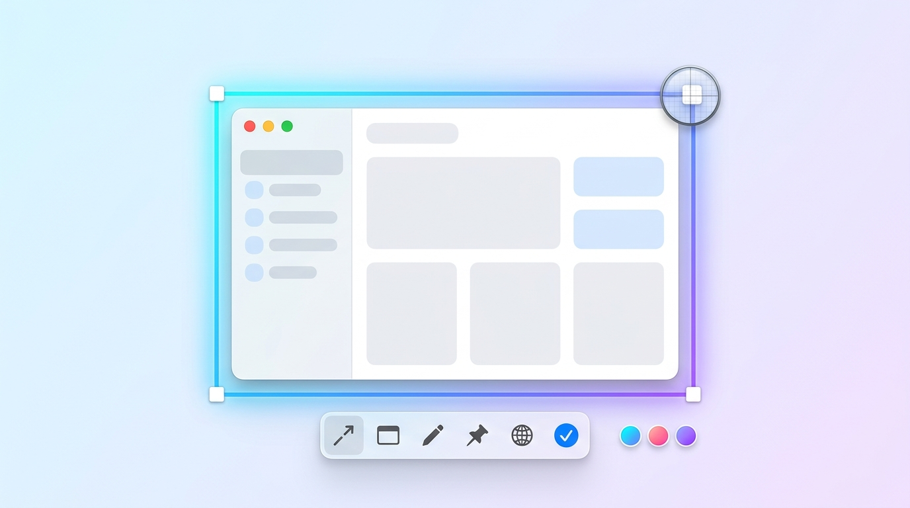
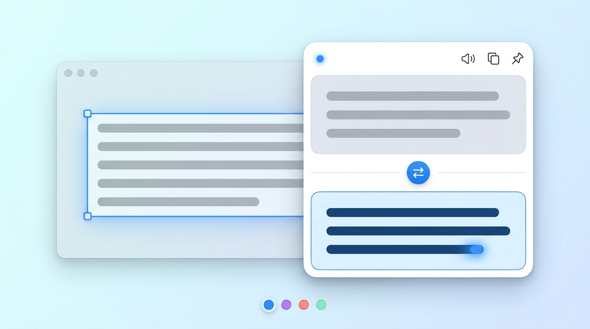

<div align="center">


<h1>TapSnap</h1>

<p>
  <strong>为 macOS 与 Windows 打造的现代化截图、贴图、标注、录屏与截图秒译工具</strong>
</p>

<p>
  <a href="https://github.com/Hsenn1015/TapSnap/releases/latest">
    
  </a>
  &nbsp;
  <a href="https://github.com/Hsenn1015/TapSnap/releases/latest">
    
  </a>
</p>

<p>
  <a href="https://github.com/Hsenn1015/TapSnap/releases/latest">
    
  </a>
  
  
  
  
</p>

<p>
  <a href="#核心能力">核心能力</a> ·
  <a href="#开源工具对比">开源对比</a> ·
  <a href="#常用快捷键">快捷键</a> ·
  <a href="#安装与源码构建">安装与构建</a> ·
  <a href="Docs/releases">版本记录</a> ·
  <a href="windows/README.md">Windows 版说明</a>
</p>

<br />

<picture>
  <source media="(prefers-color-scheme: dark)" srcset="assets/readme/hero-bento-dark.jpg" />
  <source media="(prefers-color-scheme: light)" srcset="assets/readme/hero-bento-light.jpg" />
  
</picture>

</div>

---

## 核心能力

<table width="100%">
  <tr>
    <td width="50%" valign="top">
      <p></p>
      <h3>✂️ 极速截图与 7 大选区边框</h3>
      <p>
        支持区域、窗口吸附、全屏与延时截图；提供极光流动、液态玻璃等 <strong>7 大选区边框风格</strong> 与多套主题配色。框选后可直接在液态玻璃工具栏一键复制、原位贴图、标注，或无缝切换至长截图与录屏。
      </p>
    </td>
    <td width="50%" valign="top">
      <p></p>
      <h3>🌐 截图秒译（5 套风格 · 流式提速）</h3>
      <p>
        框选松手即译，内置 <strong>极简分块卡片</strong>、液态玻璃语义胶囊、聚光取词、原地双语高亮与灵动岛气泡 5 套风格；支持 Apple 离线、Google、百度、DeepL、微软、腾讯、有道、Qwen-MT、DeepSeek 与本机 Ollama，浮卡内随时切换引擎。
      </p>
    </td>
  </tr>
  <tr>
    <td width="50%" valign="top">
      <p></p>
      <h3>📌 桌面贴图与 6 款质感阴影</h3>
      <p>
        支持截图 <code>⌘T</code> 原位贴图（过渡无闪动）与剪贴板贴图，提供置顶、分组、透明度调节、鼠标穿透与历史贴图找回；内置自适应取色溢光、磨砂画框等 <strong>6 款贴图阴影</strong>，右键即可快速切换并调节浓淡与扩散。
      </p>
    </td>
    <td width="50%" valign="top">
      <p></p>
      <h3>📜 滚动长截图</h3>
      <p>
        支持自动或手动滚动智能拼接长页面，自动识别并去除固定顶栏/侧边栏重复内容；设置页提供慢速 / 标准 / 快速预设与重叠比例微调，拼接完成后可直接继续标注、打码、复制或贴图。
      </p>
    </td>
  </tr>
  <tr>
    <td width="50%" valign="top">
      <p></p>
      <h3>🎥 录屏动效、时段标注与 GIF 倍速</h3>
      <p>
        内置 <strong>19 款鼠标动效</strong>（14 款点击 + 5 款滚轮）、实时快捷键显示与摄像头画中画；录完支持逐帧裁剪、在时间轴上为指定时段添加箭头/文字/打码，一键复制或导出 MP4 与 <code>0.25×–4×</code> 倍速 GIF。
      </p>
    </td>
    <td width="50%" valign="top">
      <p></p>
      <h3>🛡️ 本机隐私打码与 OCR / 公式</h3>
      <p>
        截图时可在本机自动识别手机号、密钥/Token、内网 IP、二维码与人脸并生成可编辑遮盖，支持自定义正则与可选 AI 补查；OCR 支持原始行、段落、Markdown 还原、表格 CSV 与本机离线 LaTeX 公式识别。
      </p>
    </td>
  </tr>
</table>

> 上述核心功能已同步覆盖 macOS 14+ 与 Windows 11，Windows 平台细节与差异见 [Windows 版说明](windows/README.md)。

---

## 开源工具对比

| 能力 | TapSnap | [Snow Shot](https://snowshot.top/guides/index.html) | [ShareX](https://getsharex.com/) | [Flameshot](https://flameshot.org/) |
| :--- | :---: | :---: | :---: | :---: |
| 截图标注 / 桌面贴图 | ✅ | ✅ | ✅ | ✅ |
| 滚动长截图 | ✅ | ✅ | ✅ | — |
| 截图秒译（多引擎 + 5 套样式） | ✅ | ✅ | — | — |
| 录屏鼠标动效 + 时间轴时段标注 | ✅ | — | — | — |
| 本机隐私自动打码（文字 / 人脸 / 二维码） | ✅ | — | — | — |
| OCR / Markdown / 表格 / 公式识别 | ✅ | ✅ | 仅 OCR | — |
| macOS & Windows 原生双端 | ✅ | ✅ | 仅 Windows | ✅ |

<sub>✅ 表示原生支持，<code>—</code> 表示官方文档未列出。Snow Shot 的表格与公式识别支持在线服务。</sub>

---

## 常用快捷键

在「设置 → 快捷键」中点击任意键帽即可自定义录制；Windows 默认使用 `Ctrl+1` 发起区域截图、`Ctrl+Shift+T` 发起截图秒译。

<table width="100%">
  <tr>
    <td width="50%" valign="top">

**全局快捷键（macOS 默认）**

| 快捷键 | 操作 |
| :--- | :--- |
| <kbd>⌘</kbd> <kbd>⇧</kbd> <kbd>1</kbd> | 区域截图 |
| <kbd>⌘</kbd> <kbd>⇧</kbd> <kbd>T</kbd> | 截图秒译 |
| <kbd>⌘</kbd> <kbd>⇧</kbd> <kbd>2</kbd> | 截图并贴图 |
| <kbd>⌘</kbd> <kbd>⇧</kbd> <kbd>V</kbd> | 剪贴板图片贴到屏幕 |
| <kbd>⌘</kbd> <kbd>⇧</kbd> <kbd>L</kbd> | 滚动长截图 |
| <kbd>⌘</kbd> <kbd>⇧</kbd> <kbd>R</kbd> | 开始 / 结束录屏 |
| <kbd>⌘</kbd> <kbd>⇧</kbd> <kbd>O</kbd> | 区域文字识别 |
| <kbd>⌘</kbd> <kbd>⇧</kbd> <kbd>H</kbd> | 剪贴板历史 |

    </td>
    <td width="50%" valign="top">

**框选与编辑器操作**

| 快捷键 | 操作 |
| :--- | :--- |
| <kbd>⌘</kbd> <kbd>T</kbd> / <kbd>Shift</kbd>+<kbd>P</kbd> | 将选区或编辑图贴回原处 |
| <kbd>Enter</kbd> | 进入标注编辑器 |
| <kbd>⌘</kbd> <kbd>C</kbd> / <kbd>Ctrl</kbd>+<kbd>C</kbd> | 复制当前结果 |
| <kbd>⌘</kbd> <kbd>S</kbd> / <kbd>Ctrl</kbd>+<kbd>S</kbd> | 选择位置保存 |
| <kbd>A</kbd> / <kbd>B</kbd> / <kbd>T</kbd> | 切换箭头 / 画笔 / 文字工具 |
| <kbd>⌘</kbd> + 滚轮 | 围绕指针缩放编辑画布 |
| <kbd>Space</kbd>（按住） | 原图覆译模式下透视原图 |
| <kbd>⌘</kbd> <kbd>1</kbd>–<kbd>9</kbd> | 设置窗口快速切换分类 |

    </td>
  </tr>
</table>

---

## 安装与源码构建

直接前往 **[GitHub Releases](https://github.com/Hsenn1015/TapSnap/releases/latest)** 下载最新正式版：

- **macOS（Apple Silicon，macOS 14+）**：提供 `.pkg` 安装向导与 `.dmg` 镜像，安装后可在菜单栏「检查更新…」获取自动更新。首次截图需在系统设置授予**屏幕录制**权限；若需优先响应全局快捷键，可按需开启**辅助功能**权限。
- **Windows（Windows 11，x64 / ARM64）**：提供 `-Setup.exe` 安装向导与便携版 `.zip`（内置完整 .NET 运行时，开箱即用）。

### 从源码构建

```bash
# macOS（需要 Xcode / Swift 工具链）
Scripts/setup-signing.sh   # 首次配置本机固定签名，后续覆盖安装可保留系统权限
Scripts/build-app.sh       # 构建正式版 dist/TapSnap.app
open dist/TapSnap.app
```

```powershell
# Windows（需要 .NET 10 SDK，详见 windows/README.md）
dotnet build windows/TapSnap.Windows.slnx -c Release
dotnet run --project windows/TapSnap.Windows -c Release
```

---

## 进阶功能与开发文档

<details>
<summary><strong>🛡️ 隐私检查与远程 AI 补查</strong></summary>
<br />

- 普通截图和长图均支持本机规则扫描。每条规则可独立设为**自动遮盖**、**仅提示**或**关闭**（支持按分组一键批量设置），也可添加自定义正则表达式。输出前可逐处复查，确认后的遮盖会随复制、保存或贴图压平到图片中。
- 可选的 AI 补查支持文字与图片定位：选择远程服务时，应用会先展示请求目的地并征得确认；图片定位前会先在本机遮盖已知敏感区域。录屏帧不经过截图隐私规则。

</details>

<details>
<summary><strong>∑ 公式识别与截图翻译细节</strong></summary>
<br />

- **公式识别**：在 macOS 菜单栏点击「公式识别」，按引导准备 Python 3.12 后即可在应用内自动安装并校验本机模型，识别全程离线运行，支持预览、编辑与一键复制 LaTeX。Windows 准备流程见 [可选本机组件](windows/README.md#可选本机组件)。
- **截图翻译**：支持通过菜单栏、全局快捷键、选区工具栏、编辑器或 OCR 结果页触发。提供**截图秒译**（5 套浮卡风格 + 浮卡内实时切换引擎 + SSE 流式提速）以及完整翻译窗口的**对照模式**（拖拽分栏、多选整理、智能滤杂、自定义排版）与**原图模式**（原位覆译按住 `Space` 透视对比、划词翻译）。
- **支持引擎**：Apple 离线翻译（macOS 15+）、Google / 百度 / DeepL / 微软 / 腾讯翻译君 / 有道翻译、本机 OpenAI 兼容模型（Ollama 等）及在线大模型（DeepSeek / 通义千问含 `qwen-mt-*` / 自定义接口）。

</details>

<details>
<summary><strong>🛠️ 开发版调试、CI 测试、签名与自动更新</strong></summary>
<br />

- **独立开发版**：在 macOS 运行 `Scripts/build-app.sh debug` 会生成 `dist/dev/TapSnap 开发版.app`，使用独立 Bundle ID（`com.sensnap.app.dev`）、独立配置与历史，可与正式版同时运行调试，菜单栏图标带「开发版」标识。
- **回归测试**：本地运行 `swift build` 与 `swift test`。推送 `main`、提交 PR 或在 [GitHub Actions](https://github.com/Hsenn1015/TapSnap/actions/workflows/build.yml) 手动运行时，会自动执行 macOS 托管环境测试与 Windows 四组回归，并输出 Artifacts（Apple Silicon DMG + Windows x64/ARM64 ZIP）。
- **发版流程**：将新版本说明写入 `Docs/releases/<标签>.md`，推送 `v*` 标签或在 **Build and release → Run workflow** 填写版本标签，双端构建通过后会自动打包签名、生成 SHA-256 清单与 Sparkle `appcast.xml`，并发布至 [GitHub Releases](https://github.com/Hsenn1015/TapSnap/releases)。
- **macOS 签名与更新源**：正式版使用长期自签名证书以在覆盖更新时保留系统授权。维护者在仓库配置 Actions 变量 `TAPSNAP_MAC_SIGNING_SHA1`、`TAPSNAP_UPDATE_PUBLIC_KEY` 及 Secrets `TAPSNAP_MAC_SIGNING_P12`、`TAPSNAP_MAC_SIGNING_PASSWORD`、`TAPSNAP_UPDATE_PRIVATE_KEY` 即可启用签名校验与 Sparkle 自动更新；临时 CI 测试可用 `TAPSNAP_ALLOW_ADHOC_SIGNING=1`。本机调试更新源可通过 `TAPSNAP_UPDATE_FEED_URL`、`TAPSNAP_UPDATE_PUBLIC_KEY`、`TAPSNAP_VERSION`、`TAPSNAP_BUILD_NUMBER` 指定。

</details>

---

<div align="center">
  <sub>
    <a href="Docs/releases">版本记录</a> ·
    <a href="windows/README.md">Windows 版说明</a> ·
    <a href="ARCHITECTURE.md">架构说明</a> ·
    <a href="THIRD_PARTY.md">第三方组件</a>
  </sub>
</div>
