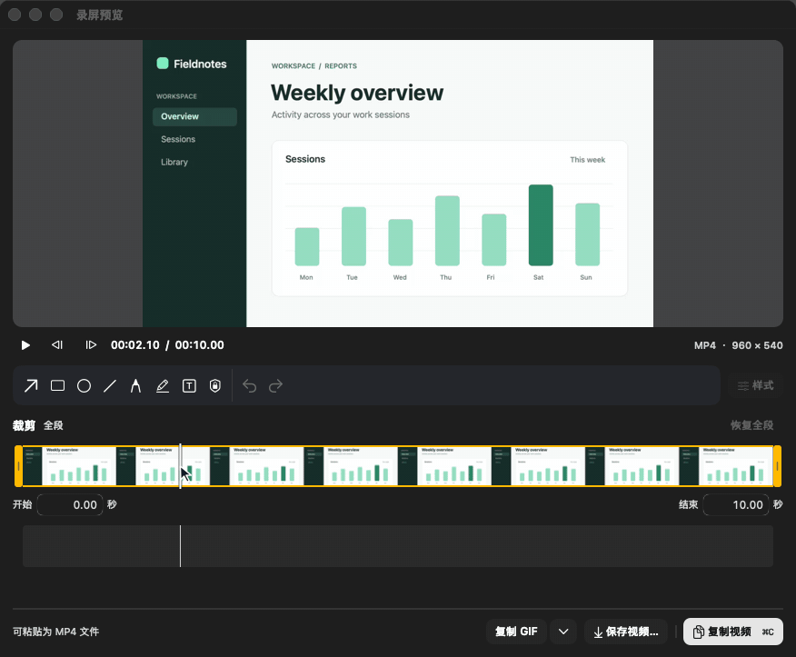
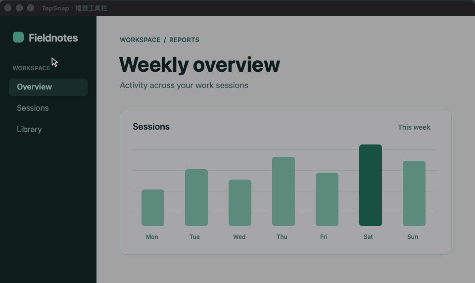

<p align="center">
  
</p>

<h2 align="center">TapSnap</h2>

<p align="center">
  <sub>macOS 与 Windows 的截图、贴图、标注和录屏工具。</sub>
</p>

<p align="center">
  
  
  
  
</p>

<p align="center">
  <sub>
    <a href="#特色功能">特色功能</a> ·
    <a href="#操作演示">操作演示</a> ·
    <a href="#安装与构建">安装与构建</a> ·
    <a href="#使用指南">使用指南</a>
  </sub>
</p>


## 特色功能

| 操作 | TapSnap 能做什么 |
| --- | --- |
| **框选后直接操作** | macOS 下可吸附窗口或控件。框选后，底部工具栏可直接复制、贴图、标注，也能转入长截图或录屏。 |
| **手绘标注与自由高亮** | 画手绘箭头和形状，调整线条起伏与填充纹理。高亮笔可沿文字或任意路径涂画。 |
| **长截图与贴图** | 连续滚动时拼接正文，固定区域只保留一次。长图完成后可继续编辑。贴图可置顶、分组、调整透明度与鼠标穿透。 |
| **给视频按时间标注** | 为单帧或一段时间添加箭头、文字、打码等标注。拖动时间条调整生效范围，成品可复制或保存为 MP4 或 GIF。 |
| **识别文字、表格与公式** | OCR 结果可按原图行、段落或 Markdown 查看，表格可复制为 CSV。公式识别提供可编辑的 LaTeX 和公式预览。 |
| **截图隐私打码** | 本机规则识别敏感文字、二维码和人脸。遮盖可移动、缩放、改样式，确认后随截图一起输出。 |

功能展示以 macOS 版为主。Windows 的操作和支持范围见 [Windows 版说明](windows/README.md)。

## 操作演示

### 录屏时间轴标注



录完可精确裁剪所选片段，也可以拖动时间轴上的标注，让它只在指定时段出现。预览底部可直接点「复制视频」或「复制 GIF」。

<details>
<summary><strong>展开观看框选与直接复制</strong></summary>



</details>

## 安装与构建

| 平台 | 源码构建 |
| --- | --- |
| **macOS 14+** | 需要 Xcode 的 Swift 工具链。执行下方命令，生成 `dist/TapSnap.app`。 |
| **Windows x64 / ARM64** | 推荐 Windows 11。构建需要 .NET 10 SDK。框架依赖的构建产物需要对应架构的 .NET 10 Desktop Runtime。详见 [Windows 构建与运行](windows/README.md#运行与构建)。 |

```bash
# macOS：构建并打开应用
Scripts/build-app.sh
open dist/TapSnap.app
```

```powershell
# Windows：构建并运行
dotnet build windows/TapSnap.Windows.slnx -c Release
dotnet run --project windows/TapSnap.Windows -c Release
```

macOS 首次截图需要授予屏幕录制权限。全局快捷键发生冲突时可以启用优先响应，这需要辅助功能权限。应用启动后可从 macOS 菜单栏或 Windows 系统托盘进入。

## 使用指南

| macOS 默认快捷键 | 操作 |
| --- | --- |
| `⌃1` | 区域截图 |
| `⌘⇧2` | 截图并贴图 |
| `⌘⇧V` | 将剪贴板里的图贴到屏幕 |
| `⌘⇧L` | 滚动长截图 |
| `⌘⇧R` | 开始或结束录屏 |
| `⌘⇧O` | 区域文字识别 |
| `⌘⇧H` | 剪贴板历史 |

在「设置 → 快捷键」可以录入自己的组合键。框选后，点勾复制，按回车打开编辑器。开启截图隐私检查时，复制前会先进入复查。Windows 默认区域截图为 `Ctrl+1`。

<details>
<summary><strong>隐私检查与远程 AI</strong></summary>

普通截图和长图可用本机规则扫描。每条规则可以设为自动遮盖、仅提示或关闭，也可以添加自己的正则。检查结果可以逐处确认，遮盖会随复制、保存或贴图压平到图片。

可选的 AI 补查支持文字或图片定位。选择远程服务时，应用会先显示目的地并请求确认。图片定位会先在本机遮住已知敏感区域。录屏帧不经过截图隐私规则。

</details>

<details>
<summary><strong>公式识别与翻译</strong></summary>

macOS 菜单栏点「公式识别」，按提示准备 Python 3.12，再在应用内安装依赖和模型。安装会校验模型文件。识别在本机进行，可编辑、预览和复制 LaTeX。

设备端翻译需要 macOS 15+，首次使用时由系统准备语言包。Windows 的组件准备见 [可选本机组件](windows/README.md#可选本机组件)。

</details>

<details>
<summary><strong>更新与开发</strong></summary>

配置更新源的 macOS 构建可通过菜单栏「检查更新…」查看新版。自动提醒会等截图、录屏和编辑结束后出现，由用户确认安装。打包时用 `TAPSNAP_UPDATE_FEED_URL` 和 `TAPSNAP_UPDATE_PUBLIC_KEY` 配置 Sparkle，使用 `TAPSNAP_VERSION` 和递增的 `TAPSNAP_BUILD_NUMBER` 标记版本。发布包需要 Sparkle 签名，更新源使用 HTTPS。本机调试支持回环 HTTP。

运行 `swift build` 编译 macOS 源码，`swift test` 跑回归测试。已有 macOS 构建沿用应用标识和配置路径，旧的 `sensnap://` 链接仍可用。

</details>

[架构说明](ARCHITECTURE.md) · [滚动长截图](Docs/long-shot-scroll-viewports.md) · [验收记录](Docs/completion-review.md) · [第三方组件](Docs/third-party-components.md)
