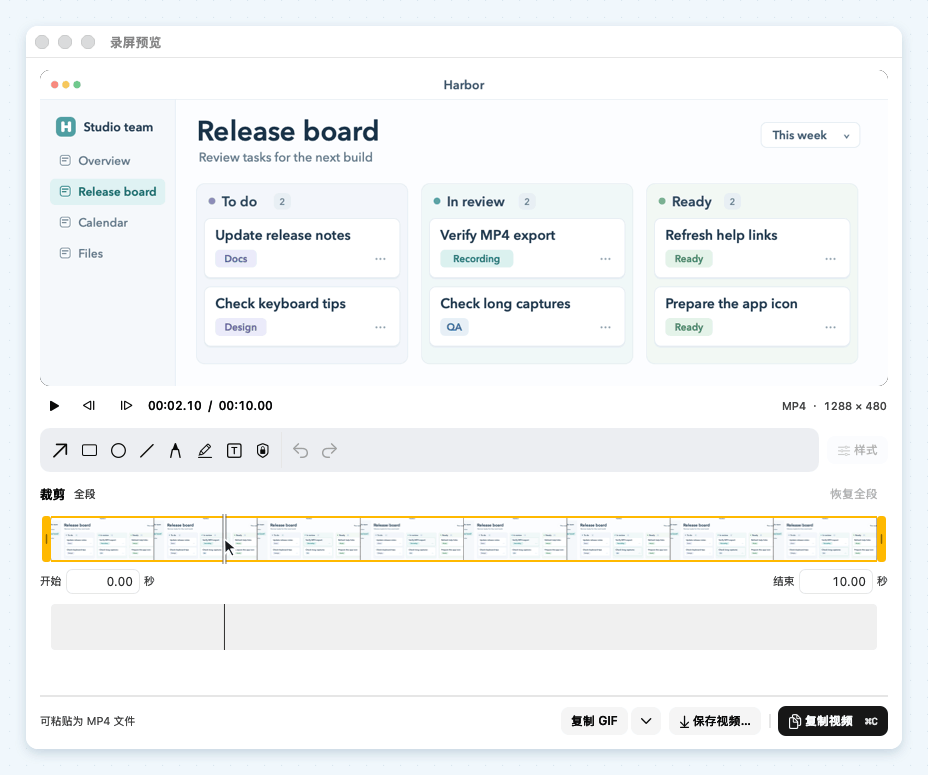

<p align="center">
  
</p>

<h2 align="center">TapSnap</h2>

<p align="center">
  <sub>macOS 与 Windows 的截图、贴图、标注和录屏工具。</sub>
</p>

<p align="center">
  
  
  
  
</p>

<p align="center">
  <sub>
    <a href="#更新说明">更新说明</a> ·
    <a href="#功能介绍">功能介绍</a> ·
    <a href="#开源工具对比">开源工具对比</a> ·
    <a href="#操作演示">操作演示</a> ·
    <a href="#安装与构建">安装与构建</a> ·
    <a href="#使用指南">使用指南</a>
  </sub>
</p>


## 更新说明

### 0.2.8 · macOS 权限修复、截图工具栏与 OCR 原图对照

- **macOS 权限** 从菜单栏打开「权限检查」，可以重新检测当前应用的录屏权限。引导窗口会保留，长说明可以滚动阅读。授权生效后可继续刚才的截图或录屏选区操作。「设置 → 快捷键」可以查看每个快捷键的冲突原因。
- **框选工具栏与文字识别** macOS 和 Windows 都可以自定义框选工具栏的常用按钮及顺序。在文字识别结果里，可以搜索文字，定位到原图对应的行或段落，再逐条复制。
- **截图标注与录屏** 两个平台都修复了点击箭头或空心形状周围空白处误选标注的问题。macOS 长截图在识别不到滚动区域时可以沿原选区手动继续。Windows 录屏控件在高缩放比例和多显示器上会保持在工作区内。

使用过 macOS 0.2.7 本地包或 0.2.4 发布包的用户，首次切换到固定签名的正式版时，系统可能需要重新确认一次权限。[查看 0.2.8 完整更新说明与安装包](https://github.com/Hsenn1015/TapSnap/releases/tag/v0.2.8)

### 0.2.7 · 主线本地构建

2026 年 11 月 20 日，主线已构建 macOS 0.2.7（build 36）以及 Windows x64、ARM64 的 0.2.7 安装包。这批安装包未随 GitHub Release 发布。[查看已发布版本](https://github.com/Hsenn1015/TapSnap/releases/latest)

### 0.2.5 · 编辑器缩放与操作快捷键

- **编辑器缩放** macOS 和 Windows 的底栏新增缩小、放大和适合窗口。按住 `⌘` 或 `Ctrl` 滚动可围绕指针缩放，放大后仍可准确标注和裁剪。
- **操作快捷键录制** 在「设置 → 快捷键 → 框选与编辑」可为贴图、复制、保存、撤销、重做、缩放和标注工具录制单键或组合键。底栏提示随键位更新。
- **直接贴图** 框选后或标注完成后，默认按 `Shift+P` 将当前图片贴到屏幕。
- **Mac 正式版签名** 使用 TapSnap 固定签名。首次从旧签名版本升级时，macOS 可能会要求重新确认截图和辅助功能权限。
- **Windows 安装包** x64 和 ARM64 的 ZIP 采用更高压缩率，并精简未使用架构的 OCR 文件。

[下载 TapSnap 0.2.5](https://github.com/Hsenn1015/TapSnap/releases/tag/v0.2.5)

### 0.2.4 · Windows 截图、录屏与剪贴板

- **截图工具栏** 框选后松开鼠标即可选择箭头、画笔等标注工具，点击后直接进入编辑。按 `Ctrl+C` 可复制选区。
- **录屏时间轴** 可点击缩略图定位、拖动两端裁剪、用左右方向键逐帧查看。箭头、文字、打码等 8 种标注可应用到指定时段或单帧。复制和保存 GIF、MP4 都会保留标注。
- **GIF 文件大小** 优化了静止画面和局部变化的编码。同一段 1280×720、15 FPS 的 5 秒桌面素材，Windows 导出文件从 0.2.3 的 27.62 MB 减至 1.95 MB。
- **剪贴板分类** 历史面板顶部可直接切换「全部」「图片」「文字」，图片记录可直接打开编辑。

[下载 TapSnap 0.2.4](https://github.com/Hsenn1015/TapSnap/releases/tag/v0.2.4)

### 0.2.3 · macOS 更新与应用信息

- **更新检查与下载** 从菜单栏选择「检查更新…」。在启用代理自动发现的 Mac 上，如果连接失败或长时间未收到响应，TapSnap 会在后台尝试系统已配置的本机代理。已开始传输的更新包继续使用当前连接。
- **应用信息** 菜单栏的「关于 TapSnap」列出了截图、贴图、录屏编辑和内容识别等主要功能。

[下载 TapSnap 0.2.3](https://github.com/Hsenn1015/TapSnap/releases/tag/v0.2.3)

### 0.2.2 · 截图与图片编辑

以下操作以 macOS 为例。[下载 TapSnap 0.2.2](https://github.com/Hsenn1015/TapSnap/releases/tag/v0.2.2)

| 功能 | 操作说明 |
| --- | --- |
| 跨屏截图 | 按 `⌃1` 启动区域截图，从一块显示器拖至另一块即可将选区截为一张图片。支持不同缩放比例的显示器，截图可直接复制、保存或编辑。 |
| 指定保存位置 | 在选区工具栏或编辑器中选择「保存」，可为本次截图指定文件夹和文件名。取消保存后可继续编辑。启用自动保存时，选择「完成」会将截图存入默认目录。 |
| 剪贴板历史分类 | 按 `⌘⇧H` 打开历史记录，按「全部」「图片」或「文字」筛选。选择记录可将内容放回剪贴板，选择图片旁的铅笔图标可直接编辑。 |
| 编辑已有图片 | 在菜单栏选择「打开图片…」以编辑本地文件，或选择「编辑剪贴板图片」以标注已复制的图片。 |
| 继续编辑最近截图 | 在菜单栏选择「编辑最近截图」，可在本次运行期间继续调整上一张普通截图的标注和裁剪范围。经过隐私复查的截图仅恢复复查后的合成图。 |
| 时间与图片水印 | 在编辑器中选择「更多 → 水印」，可添加文字、截屏时间或自定义 PNG 图片。时间格式可选「仅日期」或「日期和时间」。图片水印支持透明背景，可移动、等比缩放并调整不透明度。 |
| 比例裁剪与按像素导出 | 裁剪支持 1:1、4:3、16:9 和 9:16 比例。在「更多 → 导出…」中可按宽度、高度或最长边等比缩放，选择格式后可查看输出尺寸和文件大小。 |
| 两图拼接 | 在编辑器中选择「更多 → 追加一张图片…」，可将两张图片水平或垂直排列，并调整先后顺序。选择「打开合成图」可继续标注、复制或保存。 |

## 功能介绍

- **截图与框选** 支持区域、窗口、全屏和延时截图。macOS 版可吸附到窗口或控件，框选后可直接复制、贴图、标注，也可切换到长截图或录屏。
- **滚动长截图** 手动或自动滚动拼接正文，固定区域只保留一次。长图完成后可继续编辑、复制、保存或贴图。
- **标注与高亮** 可添加箭头、形状、文字、序号和马赛克。手绘样式支持调整线条起伏与填充纹理，高亮笔可沿任意路径涂画。
- **贴图与剪贴板历史** 把截图或剪贴板图片固定在桌面上，支持置顶、分组、调节透明度和鼠标穿透，也可从历史记录找回图片或文字。
- **录屏与编辑** 支持录制选定区域，录完可以裁剪、逐帧预览，并在单帧或指定时段加上箭头、文字或打码。可直接复制视频或 GIF，也可保存为 MP4 或 GIF。
- **文字、表格与公式识别** 文字可按原始行、段落或 Markdown 查看，表格可复制为 CSV。安装公式识别组件后，可以预览、编辑和复制 LaTeX。
- **隐私检查** 截图时可在本机检查敏感文字、二维码和人脸。复制、保存或贴图前可以调整遮盖范围与样式，确认后随图片一起输出。

列表与演示以 macOS 版为例。Windows 的操作和支持范围见 [Windows 版说明](windows/README.md)。

## 开源工具对比

| 功能 | TapSnap | [Snow Shot](https://snowshot.top/guides/index.html) | [ShareX](https://getsharex.com/) | [Flameshot](https://flameshot.org/) |
| --- | :---: | :---: | :---: | :---: |
| 截图标注 | ✅ | ✅ | ✅ | ✅ |
| 滚动长截图 | ✅ | ✅ | ✅ | — |
| 桌面贴图 | ✅ | ✅ | ✅ | ✅ |
| 录屏 / GIF | ✅ | ✅ | ✅ | — |
| 录屏时段标注 | ✅ | — | — | — |
| 文字识别 | ✅ | ✅ | ✅ | — |
| 表格与公式识别 | ✅ | ✅ | — | — |

✅ 表示支持，`—` 表示官方文档未列出。TapSnap 以 macOS 版为例。Snow Shot 的表格和公式识别可使用在线服务。

## 操作演示

### 录屏时间轴标注



录完可精确裁剪所选片段，也可以拖动时间轴上的标注，让它只在指定时段出现。预览底部可直接点「复制视频」或「复制 GIF」。

<details>
<summary><strong>展开观看框选与直接复制</strong></summary>


</details>

## 安装与构建

| 平台 | 源码构建 |
| --- | --- |
| **macOS 14+** | 需要 Xcode 的 Swift 工具链。执行下方命令，生成 `dist/TapSnap.app`。 |
| **Windows x64 / ARM64** | 推荐 Windows 11。构建需要 .NET 10 SDK。框架依赖的构建产物需要对应架构的 .NET 10 Desktop Runtime。详见 [Windows 构建与运行](windows/README.md#运行与构建)。 |

```bash
# macOS：首次在本机开发时创建签名身份，以后重复使用
Scripts/setup-signing.sh
Scripts/build-app.sh
open dist/TapSnap.app
```

```powershell
# Windows：构建并运行
dotnet build windows/TapSnap.Windows.slnx -c Release
dotnet run --project windows/TapSnap.Windows -c Release
```

macOS 首次截图需要授予屏幕录制权限。全局快捷键发生冲突时可以启用优先响应，这需要辅助功能权限。应用启动后可从 macOS 菜单栏或 Windows 系统托盘进入。

## 使用指南

| macOS 默认快捷键 | 操作 |
| --- | --- |
| `⌃1` | 区域截图 |
| `⌘⇧2` | 截图并贴图 |
| `⌘⇧V` | 将剪贴板里的图贴到屏幕 |
| `⌘⇧L` | 滚动长截图 |
| `⌘⇧R` | 开始或结束录屏 |
| `⌘⇧O` | 区域文字识别 |
| `⌘⇧H` | 剪贴板历史 |

在「设置 → 快捷键」可录制全局快捷键。下方的「框选与编辑」支持为贴图、复制、保存、撤销、重做、画布缩放和标注工具录制单键或组合键。Windows 默认按 `Ctrl+1` 开始区域截图。

框选完成后，默认可按 `A` 选箭头、`B` 选画笔、`T` 选文字，进入编辑器后也能用同一套键位切换工具。工具栏悬停提示和「更多」菜单显示当前键位。按回车打开编辑器，默认按 `Shift+P` 将当前选区或标注成品贴到屏幕，按 `⌘C`／`Ctrl+C` 复制，按 `⌘S`／`Ctrl+S` 选择保存位置。开启截图隐私检查时，输出前会先进入复查。

编辑图片时，可用底栏的 `−` 和 `+` 缩放画布，点击百分比恢复适合窗口。macOS 按住 `⌘`、Windows 按住 `Ctrl` 滚动鼠标滚轮，可围绕指针缩放。缩放只影响编辑时的显示比例。

<details>
<summary><strong>隐私检查与远程 AI</strong></summary>

普通截图和长图可用本机规则扫描。每条规则可以设为自动遮盖、仅提示或关闭，也可以添加自己的正则。检查结果可以逐处确认，遮盖会随复制、保存或贴图压平到图片。

可选的 AI 补查支持文字或图片定位。选择远程服务时，应用会先显示目的地并请求确认。图片定位会先在本机遮住已知敏感区域。录屏帧不经过截图隐私规则。

</details>

<details>
<summary><strong>公式识别与翻译</strong></summary>

macOS 菜单栏点「公式识别」，按提示准备 Python 3.12，再在应用内安装依赖和模型。安装会校验模型文件。识别在本机进行，可编辑、预览和复制 LaTeX。

设备端翻译需要 macOS 15+，首次使用时由系统准备语言包。Windows 的组件准备见 [可选本机组件](windows/README.md#可选本机组件)。

</details>

<details>
<summary><strong>更新与开发</strong></summary>

推送 `main`、提交面向 `main` 的 PR，或在 [GitHub Actions](https://github.com/Hsenn1015/TapSnap/actions/workflows/build.yml) 手动运行时，会执行 macOS 托管环境回归测试与 Windows 四组回归，并在运行详情的 Artifacts 提供 Apple Silicon DMG 和两种架构的自包含 Windows ZIP。需要实际桌面、系统编码器和识别环境的 macOS 用例可在本机运行 `swift test`。

发布主线版本时，可以在 **Build and release → Run workflow** 中选择 `main`，填写版本标签（例如 `v0.2.8`）。两端构建通过后，流程为本次构建的提交打标签，并将安装包、SHA-256 校验清单和 `Docs/releases/<标签>.md` 中的更新说明发布到 [GitHub Releases](https://github.com/Hsenn1015/TapSnap/releases)。直接推送版本标签也可以触发发布。手动运行时留空版本标签只执行 CI。

macOS 正式版使用 TapSnap 专用的长期自签名证书。从 GitHub 首次下载安装时，macOS 可能提示无法验证开发者。维护者在仓库 Actions 变量 `TAPSNAP_MAC_SIGNING_SHA1` 中填写签名证书的 40 位 SHA-1 指纹，将加密 PKCS#12 文件的 Base64 内容和密码分别存入 Actions Secrets `TAPSNAP_MAC_SIGNING_P12`、`TAPSNAP_MAC_SIGNING_PASSWORD`。发布时会校验安装包的签名。维护者也可在主分支手动运行 **Verify macOS upgrade signing**，用两个构建验证升级前后的签名身份。

主线 0.2.4 发布包使用临时签名，0.2.5 发布包开始使用固定证书，因此这次升级可能需要重新授权。后续版本沿用相同的 Bundle ID 和证书时，覆盖安装通常可以保留授权。本地构建如果使用另一张证书，macOS 也可能重新询问。系统设置已开启但截图仍失败时，可从菜单栏打开「权限检查」验证当前运行的 TapSnap。窗口会保留检测结果；当前进程仍被拒绝时，可以选择「重新打开 TapSnap」。

本地持续使用的构建请保留首次使用的证书及私钥。多人或多台构建机分发同一版本线时，请在打包机上使用同一分发身份。没有固定身份的临时 CI 测试可设置 `TAPSNAP_ALLOW_ADHOC_SIGNING=1`，此类构建更新后可能需要重新授权。正式和预发布标签均使用固定证书。

配置更新源的 macOS 构建可通过菜单栏「检查更新…」查看新版。自动提醒会等截图、录屏和编辑结束后出现，由用户确认安装。

为仓库设置 Actions 变量 `TAPSNAP_UPDATE_PUBLIC_KEY` 和 Actions Secret `TAPSNAP_UPDATE_PRIVATE_KEY`，分别填入 Sparkle 公钥和当前版 `generate_keys -x` 导出的私钥。配置后，正式版本标签会生成已签名的更新包和 `appcast.xml`，一并发布到 GitHub Releases。应用从最新正式 Release 读取清单。此前未配置更新源的版本需要手动覆盖安装一次。

本机测试可用 `TAPSNAP_UPDATE_FEED_URL` 和 `TAPSNAP_UPDATE_PUBLIC_KEY` 配置回环更新源。使用 `TAPSNAP_VERSION` 和递增的 `TAPSNAP_BUILD_NUMBER` 标记版本。

运行 `swift build` 编译 macOS 源码，`swift test` 跑回归测试。已有 macOS 构建沿用应用标识和配置路径，旧的 `sensnap://` 链接仍可用。

</details>

[架构说明](ARCHITECTURE.md) · [第三方组件](THIRD_PARTY.md)
